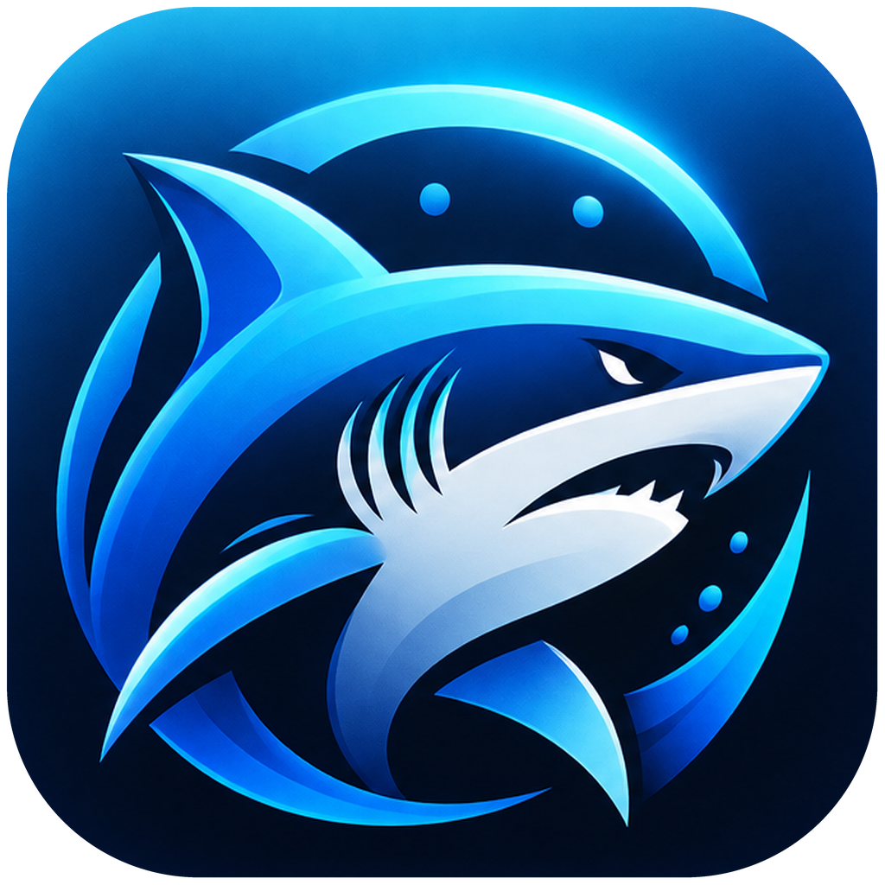
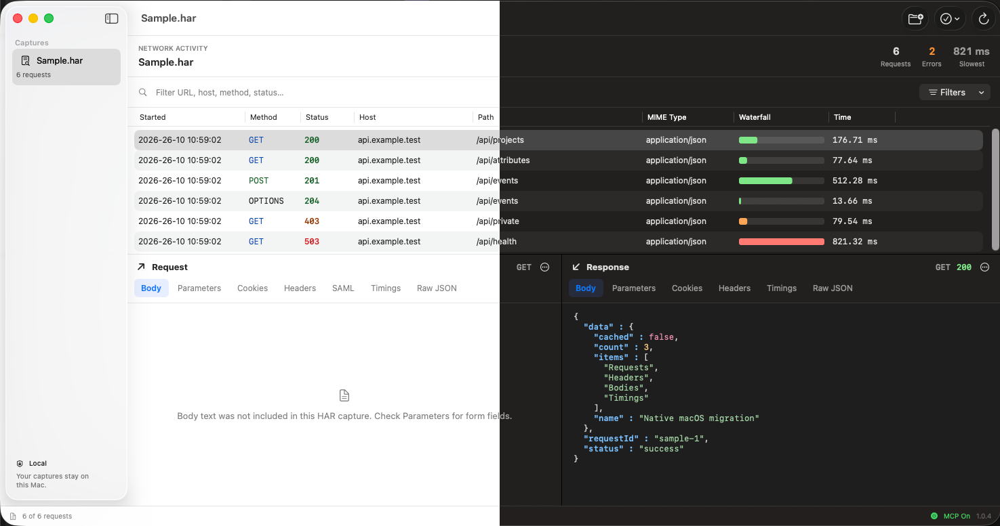
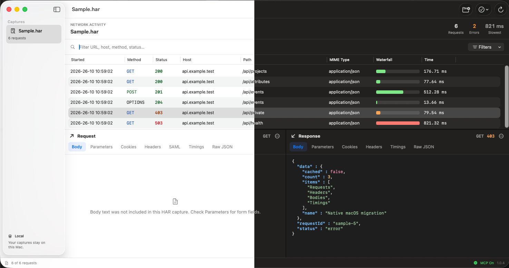

<p align="center">
  
</p>
<h1 align="center">HarsharkNGX</h1>
<p align="center"><strong>See the whole request.</strong><br>A native macOS HAR viewer built with SwiftUI and AppKit.</p>
<p align="center">
  <a href="#build--run">Build &amp; run</a> ·
  <a href="native/HarsharkNGX/MCP-SETUP.md">MCP setup</a> ·
  <a href="native/HarsharkNGX/CHANGELOG.md">Changelog</a> ·
  <a href="README-PYSIDE6.md">Python / PySide6 version</a>
</p>



**Native v1.0.3 is available** from [GitHub Releases](https://github.com/teezyyoxo/HarsharkNGX/releases/tag/native-v1.0.3). Download the ZIP, extract it, and move `HarsharkNGX.app` to `/Applications`. The app includes its MCP helper and a guided privacy and permissions setup. Prefer the cross-platform Python app? Its original [installation and usage guide](README-PYSIDE6.md) is preserved separately.

**New in 1.0.3:** opened and reloaded HARs become available to MCP automatically. Claude and other local MCP agents can also load a HAR directly, with no extra HarsharkNGX confirmation steps. See the [1.0.3 release notes](https://github.com/teezyyoxo/HarsharkNGX/releases/tag/native-v1.0.3) for changes and upgrade instructions.

## Explore your captures

- **Keep captures together.** Open multiple HAR files, switch between them, or start with the built-in sample.
- **Find the request.** Search, filter, and sort a customizable table with HTTP status colors and waterfall timings.
- **Fit the capture.** Opening or switching HAR files automatically sizes the window for visible columns, request count, and payload previews, within the current display. Columns keep readable content widths; long tables and payloads scroll when they exceed the screen. Inspector tabs wrap in narrow panes.
- **Inspect both sides.** Explore request and response bodies, headers, cookies, parameters, and timings with formatted JSON and syntax highlighting.
- **Make it yours.** Choose system, light, or dark appearance; adjust columns, density, timestamps, and body previews in Settings.
- **Work locally.** Inspect files on your Mac, export redacted summaries, and automatically make open captures available to MCP clients.



*Explore the bundled sample capture and inspect individual requests and responses.*

## Build & run

**Requirements:** macOS 26.7 or later for the current app target, and Xcode with a compatible macOS SDK and Swift 6.2 or later. The current build is verified with Xcode 27.1. No Python or Qt runtime is required for the native app.

```sh
git clone https://github.com/teezyyoxo/harsharkngx.git
cd harsharkngx
open native/HarsharkNGX/HarsharkNGX.xcodeproj
```

1. Select the **HarsharkNGX** scheme and **My Mac** destination.
2. If Xcode requests signing credentials, select your own team under **Signing & Capabilities**.
3. Press **⌘R** to build and run, or **⌘B** to build only.

Choose **Open HAR Files**, drop a `.har` file into the window, or try the sample capture. Use **⌘,** for Settings. Closing the final capture returns to the welcome screen.

### macOS Security & Gatekeeper

Native macOS development and pre-release builds may not yet be signed with an Apple Developer ID or notarized by Apple. When first opening a downloaded build, Gatekeeper may warn that the developer cannot be verified or Apple cannot check the app for malicious software. This means macOS cannot verify its developer identity or notarization; it is not, by itself, a malware detection or an assurance of safety.

If you trust the download from the official project repository or release page and are confident it has not been tampered with:

1. Attempt to open `HarsharkNGX.app`, then dismiss the warning.
2. Open **System Settings → Privacy & Security**, scroll to **Security**, and select **Open Anyway**.
3. Authenticate if prompted and confirm **Open**.

Keep Gatekeeper enabled. If macOS reports malware, says the app will damage your computer, or says it is damaged, stop and verify the download with the maintainers instead. See [Apple’s guide to safely opening apps](https://support.apple.com/en-us/102445).

Apple Developer ID signing and Apple notarization are planned for future public distributions; no release date is set.

## Connect Claude or another agent with MCP

Open **Help → Setup Assistant** (also available in **Settings → MCP Integration**). It opens automatically on a fresh installation when no app preferences or configuration exist and guides you through:

1. **Install / Upgrade Helper:** choose an installation folder, normally `~/Library/Application Support/HarsharkNGX/bin`. The bundled helper installs without Xcode or a source checkout.
2. **Allow shared capture access:** add the installed `HarsharkMCP.app` to **System Settings → Privacy & Security → Full Disk Access** and enable its switch. Click **Check Access**; the status updates every second with a green checkmark when the helper can read shared data. If macOS stops the helper after changing permissions, click **Check Access** again.
3. **Connect Claude:** copy the configuration entry and merge it into Claude Desktop’s configuration, preserving other servers. Select that file in the assistant to verify changes as you save them, then fully quit and reopen Claude.

Full Disk Access prevents the recurring “would like to access data from other apps” prompt, but grants broad filesystem access. It is optional for ordinary HAR viewing. The assistant checks effective access to HarsharkNGX data, not the Full Disk Access switch or a live Claude connection; it never changes macOS privacy settings or Claude’s configuration. Merely opening the assistant does not start a permission request.

The MCP server runs independently of the GUI. Claude or any other client supporting local stdio MCP servers launches it on demand. In 1.0.3, opening or reloading a HAR automatically shares its full snapshot while MCP is on, including captures opened through Finder, drag-and-drop, the sample, or restoration. Clients discover these with `list_sessions` and `open_session`. You can also give an agent a local HAR path and have it call `load_har` directly, without opening the GUI first.

MCP is enabled by default; use the bottom-right **MCP On / MCP Off** button to disable or re-enable access. Turning it on shares captures already open. HarsharkNGX adds no per-capture or per-tool confirmation. Tools declare their local, read-only behavior through standard MCP annotations; macOS and the agent app still control their own permission prompts. Use the same installed executable in other clients’ local MCP server settings. An upgrade may require adding or re-enabling the helper’s permission entry.

For a source-based installation, run from the repository root:

```sh
cd native/HarsharkNGX
./scripts/install-mcp.sh
```

Then follow the [Claude configuration guide](native/HarsharkNGX/MCP-SETUP.md). The installer uses a stable per-user location, so Claude does not depend on an Xcode build folder.

## Development

Run the app and UI tests in Xcode with **⌘U**. Run the shared core tests from Terminal:

```sh
cd native/HarsharkNGX
swift test
```

[Validation & known limitations](native/HarsharkNGX/VALIDATION.md) · [Performance measurements](native/HarsharkNGX/PERFORMANCE.md) · [Native changelog](native/HarsharkNGX/CHANGELOG.md)

The native migration is still being refined; complete Python feature parity and Developer ID signing/notarization are not yet claimed. Downloaded builds are ad hoc signed.

---

Inspired by the original [Harshark](https://github.com/MacroPolo/harshark) by MacroPolo.
