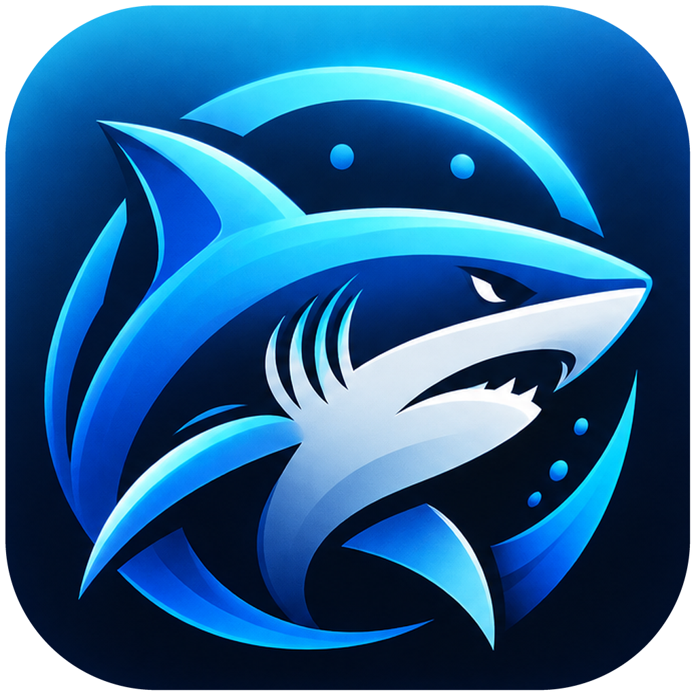

<p align="center">
  
</p>
<h1 align="center">HarsharkNGX</h1>
<p align="center"><strong>See the whole request.</strong><br>A native macOS HAR viewer built with SwiftUI and AppKit.</p>
<p align="center">
  <a href="#build--run">Build &amp; run</a> ·
  <a href="native/HarsharkNGX/MCP-SETUP.md">MCP setup</a> ·
  <a href="native/HarsharkNGX/CHANGELOG.md">Changelog</a> ·
  <a href="README-PYSIDE6.md">Python / PySide6 version</a>
</p>

<!-- Future native hero/banner and screenshots belong here. -->

**Native v1.0.0 is in development** on `feature/native-swift-macos`. Build from source to try it today. Prefer the cross-platform Python app? Its original [installation and usage guide](README-PYSIDE6.md) is preserved separately.

## Explore your captures

- **Keep captures together.** Open multiple HAR files, switch between them, or start with the built-in sample.
- **Find the request.** Search, filter, and sort a customizable table with HTTP status colors and waterfall timings.
- **Inspect both sides.** Explore request and response bodies, headers, cookies, parameters, and timings with formatted JSON and syntax highlighting.
- **Make it yours.** Choose system, light, or dark appearance; adjust columns, density, timestamps, and body previews in Settings.
- **Work locally.** Inspect files on your Mac, export redacted summaries, and explicitly share capture snapshots with MCP clients.

## Build & run

**Requirements:** macOS 26.7 or later for the current app target, and Xcode with a compatible macOS SDK and Swift 6.2 or later. The current build is verified with Xcode 27.1. No Python or Qt runtime is required for the native app.

```sh
git clone --branch feature/native-swift-macos https://github.com/teezyyoxo/harsharkngx.git
cd harsharkngx
open native/HarsharkNGX/HarsharkNGX.xcodeproj
```

1. Select the **HarsharkNGX** scheme and **My Mac** destination.
2. If Xcode requests signing credentials, select your own team under **Signing & Capabilities**.
3. Press **⌘R** to build and run, or **⌘B** to build only.

Choose **Open HAR Files**, drop a `.har` file into the window, or try the sample capture. Use **⌘,** for Settings. Closing the final capture returns to the welcome screen.

## Connect Claude with MCP

The native MCP server runs independently of the GUI. Claude launches it on demand over stdio; it can read explicitly supplied HAR files or snapshots shared from the app.

From the repository root:

```sh
cd native/HarsharkNGX
./scripts/install-mcp.sh
```

Then follow the [Claude configuration guide](native/HarsharkNGX/MCP-SETUP.md). The installer uses a stable per-user location, so Claude does not depend on an Xcode build folder.

## Development

Run the app and UI tests in Xcode with **⌘U**. Run the shared core tests from Terminal:

```sh
cd native/HarsharkNGX
swift test
```

[Validation & known limitations](native/HarsharkNGX/VALIDATION.md) · [Performance measurements](native/HarsharkNGX/PERFORMANCE.md) · [Native changelog](native/HarsharkNGX/CHANGELOG.md)

The native migration is still being refined; complete Python feature parity and a signed, packaged release are not yet claimed.

---

Inspired by the original [Harshark](https://github.com/MacroPolo/harshark) by MacroPolo.
